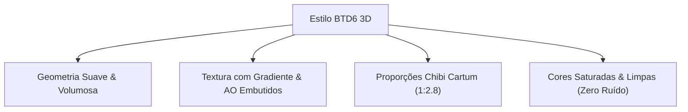

# 🎨 Guia de Direção de Arte & Identidade Visual — Dwarves TD

Este documento estabelece a **Bíblia de Estilo Visual Oficial** do jogo **Dwarves TD**, definindo o padrão **Stylized Cartoon 3D (Estilo Bloons TD 6)** para modelagem 3D, texturização, shaders URP e interface de usuário (HUD/UI).

---

## 🎯 1. O Padrão Visual: "BTD6 Stylized 3D"

O jogo adota a estética visual exata de **Bloons TD 6**: personagens e torres com visual de **"figuras colecionáveis de vinil"** — amigáveis, coloridos, volumosos e com leitura visual instantânea na câmera distante.

> [!IMPORTANT]
> **A Regra de Ouro da Câmera Top-Down (58° a 17m de distância):**
> O jogador enxerga as unidades de cima. Detalhes pequenos na cintura ou nos pés viram ruído visual insignificante. Todo o esforço de modelagem e silhueta deve se concentrar no **topo**: **cabeça, elmos, barbas, ombreiras e armas**.

---

## 📐 2. Modelagem 3D & Proporções (Blender / Maya / 3ds Max)

### 🧔 Os Anões (Defensores)
- **Proporção Chibi Cartum:** Altura de **2.5 a 3.0 cabeças**.
- **Silhueta Troncuda:** Ombros largos quase na mesma largura da altura corporal, passando solidez inabalável de rocha.
- **Barbas Esculpidas:** A barba é a assinatura de cada torre. Deve ser modelada como uma massa volumosa sólida com tranças ou mechas estilizadas largas (evitar fios de cabelo individuais).
- **Mãos e Armas Exageradas:** Machados, martelos, bacamartes e chaves de fenda com proporção **30% a 40% maior** que a anatomia realista, garantindo que o jogador identifique o papel da torre em uma fração de segundo.
- **Topologia & Sombreamento:**
  - **Smooth Shading / Weighted Normals:** Sem facetas poligonais secas.
  - **Chunky Bevels:** Arestas e cantos chanfrados e arredondados para capturar a luz suavemente como um brinquedo estilizado.

### 👺 Os Goblins (Inimigos)
- **Proporção Ágil:** Corpos esguios, curvados para frente, braços longos e orelhas pontudas compridas.
- **Diferenciação Visual Instantânea:**
  - *Recruta:* Pequeno (0.8m), pele verde viva, expressão ágil.
  - *Corredor:* Tronco encolhido, postura quase de quatro patas, capacete aerodinâmico amarelo brilhante.
  - *Blindado:* Cuboide robusto, coberto por placas de ferro quadrangulares arredondadas nas pontas.
  - *Troll Chefe:* Colosso rochoso (2.2m de altura — mais que o dobro do anão), silhueta maciça triangular invertida.

---

## 🖌️ 3. Pipeline de Texturização (O Segredo do BTD6)

A chave da estética do *Bloons TD 6* está na forma como as texturas são pintadas:

1. **Iluminação Assada na Textura (Hand-Painted Light Gradient):**
   - O mapa de textura (*Base Color / Albedo*) possui um gradiente vertical sutil: **o topo da cabeça/ombros é mais claro e a base dos pés é mais escura**.
   - As dobras, fendas e junções de armadura recebem sombras suaves de oclusão ambiental (*Ambient Occlusion*) pintadas diretamente na cor.
2. **Zero Ruído Fotográfico:**
   - **NUNCA** use texturas realistas com poros de pele, ferrugem fina ou micro-arranhões. A câmera top-down transforma texturas realistas em borrões ruidosos.
   - Use blocos de cores puras, limpas e saturadas, com variações de tom largas e legíveis.
3. **Mapas de Textura (URP Lit):**
   - **Base Map (Albedo):** 1024x1024 atlas compartilhado ou 512x512 por unidade.
   - **Smoothness:** Valor constante suave entre `0.35` e `0.45` (brilho suave de plástico/resina acetinada).
   - **Metallic:** Usado pontualmente apenas em placas de ferro e lâminas (`0.6 - 0.8`), mantendo madeiras, couros e peles em `0.0`.
   - **Normal Map (Opcional):** Apenas relevos suaves e largos (*Chunky Details*); pode ser dispensado para economizar memória e draw calls.

---

## 🎨 4. Código de Cores das 4 Guildas dos Anões

Cada categoria possui uma paleta temática marcante que se reflete tanto no modelo 3D quanto nos cards da interface:

| Guilda | Função Tática | Paleta Principal | Material Chave |
| :--- | :--- | :--- | :--- |
| **Clã Combatente** | Dano direto rápido | Bronze Quente (`#D97724`) + Vermelho Escarlate (`#B82626`) | Couro curtido e placas de bronze |
| **Engenharia & Cerco** | Dano em área / Anti-armadura | Cinza Ferro Grafite (`#3A3D40`) + Latão (`#D4AF37`) | Barris de pólvora e madeira de carvalho |
| **Forja Rúnica & Magia** | Dano mágico / Lentidão e gelo | Basalto Escuro (`#1A232E`) + Ciano Místico Glow (`#00E5FF`) | Cristais rúnicos translúcidos brilhantes |
| **Mineração & Suporte** | Economia e auras de suporte | Madeira Rústica (`#6E4720`) + Ouro Puro Polido (`#FFD700`) | Vigas de madeira, pepitas e carrinhos |
| **Herói do Clã** | Liderança e habilidades ativas | Ouro Real (`#F1C40F`) + Vermelho Barba-de-Fogo (`#A93226`) | Elmo com chifres dourados e ombreiras reais |

---

## 🖥️ 5. Identidade da HUD & UI (Estilo BTD6 PC)

A interface para PC do *Dwarves TD* segue as seguintes diretrizes ergonômicas e visuais:

1. **Barra Superior de Status (Top Bar):**
   - Fundo escuro com bordas ligeiramente arredondadas (Radius 12px) e contorno suave.
   - **Vidas:** Ícone de Escudo/Coração vermelho com número em fonte bold branca e contorno escuro.
   - **Ouro:** Ícone de Moeda/Pepita dourada brilhante com contador em amarelo ouro (`#FFD700`).
   - **Rodadas:** Banner de tecido anão exibindo a rodada atual e a meta (`Rodada 5 / 10`).
   - **Velocidade:** Botões táteis com ícones de `1x` e `2x` em verde brilhante.
2. **Gaveta Lateral de Torres (Right Drawer):**
   - Abas superiores destacadas por cores correspondentes a cada guilda (Clã, Cerco, Runas, Apoio).
   - Cards das torres com cantos arredondados, ilustração/ícone do anão em destaque, nome em negrito e custo em dourado.
   - Seção destacada no topo da gaveta para o **Herói**, com avatar, barra de XP fluida e botão de habilidade ativa com animação de contorno brilhante quando pronta.
3. **Tipografia:**
   - Fonte primária robusta, geométrica e limpa, sem serifa (ex: *Lilita One*, *Bebas Neue*, *Nunito ExtraBold* ou *Montserrat Black*).
   - Textos funcionais sempre com contraste perfeito sobre fundos claros ou escuros.
