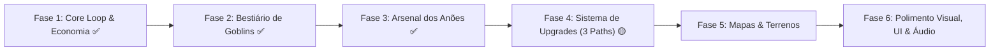

# 🗺️ Roadmap de Desenvolvimento — Dwarves TD

Este documento reúne o planejamento completo de desenvolvimento do jogo **Dwarves TD**, inspirado nas melhores mecânicas de *Bloons TD 6* com a temática de **Anões vs Goblins**. Conforme alinhamos as decisões, este roadmap será atualizado continuamente.

---

## 📌 Visão Geral dos Pilares de Produção

---

## 📋 Status Atual do Projeto

| Sistema | Status | Descrição |
| :--- | :---: | :--- |
| **Câmera Top-Down Fixa** | ✅ Concluído | Ângulo de 58° ortográfico/perspectiva (estilo BTD6). |
| **Caminho & Waypoints** | ✅ Concluído | Traçado com cálculo de distância percorrida (`DistanceTraveled`). |
| **Mira BTD6 ("First", etc.)** | ✅ Concluído | Foco no primeiro goblin do caminho com rotação suave. |
| **Blindagem de Performance** | ✅ Concluído | Generic Object Pooling, distância ao quadrado e Forward rendering URP (60–120 FPS). |
| **Otimização Extrema de FPS** | ✅ Concluído | MaterialPropertyBlock (zero clones), remoção de colisores em projéteis, eliminação de raízes quadradas no PathFollower e cache de strings na HUD. |
| **Posicionamento de Torres** | ✅ Concluído | Sistema de compra e colocação no chão com mouse, preview de alcance e suporte às 4 guildas + Herói. |
| **Bestiário de Goblins (4 Tipos)** | ✅ Concluído | Recruta (Verde), Corredor (Amarelo veloz), Blindado (Cinza aço resistente) e Troll Chefe (Marrom). |
| **Divisão no Caminho (`SplitOnDeath`)**| ✅ Concluído | Monstro pai estoura em 3 recrutas no mesmo ponto da trilha ao morrer (estilo MOAB). |
| **Tabela Curada das 10 Rodadas** | ✅ Concluído | Progressão rítmica com escalonamento de dificuldade e recompensas até a Rodada 10. |
| **Torre 1: Besteiro Anão** | ✅ Concluído | Clã Combatente: $120 ouro, tiro direto rápido com machados. |
| **Torre 2: Canhoneiro de Pólvora** | ✅ Concluído | Engenharia & Cerco: $250 ouro, dano em área (AoE 2.5m), ignora blindagens. |
| **Torre 3: Ferreiro Rúnico** | ✅ Concluído | Forja Rúnica & Alquimia: $320 ouro, dano mágico, penetra blindagens e aplica lentidão/gelo de 45% por 2.5s. |
| **Torre 4: Mina de Ouro dos Anões** | ✅ Concluído | Mineração & Suporte: $400 ouro, economia estilo Banana Farm com rendimento de +80 ouro no término de cada rodada. |
| **Herói: Comandante Thorin** | ✅ Concluído | Liderança do Clã: $150 ouro (limite 1 por partida), progressão Níveis 1–10, ganho de XP por abate/rodada e habilidade ativa "Grito de Guerra". |

---

## 🛠️ Fases Planejadas

### [Fase 1] — Core Loop, Regras de Jogo & HUD
- [x] **Fluxo de Ouro por Rodada:** Bônus de ouro ao vencer cada rodada ($100 + 5 \times rodada$, estilo BTD6).
- [x] **Condição de Derrota:** Se vidas chegarem a 0, jogo pausa e exibe tela de "A Fortaleza Caiu" com botão de reiniciar.
- [x] **Condição de Vitória:** Ao completar a meta de 10 rodadas, jogo pausa e exibe tela de "Vitória Anã" com botão de reiniciar.
- [x] **HUD Oficial PC:** Barra superior de Vidas/Ouro/Rodada/Velocidade + Painel lateral com abas das 4 Categorias de Torres.

### [Fase 2] — O Bestiário de Goblins & Progressão de Ondas (Estilo BTD6)
- [x] **Definição da Mecânica Central (Opção C - Híbrido):** Goblins com vida/velocidade próprias + Monstros/Chefões que se dividem ao morrer.
- [x] **Mecânica de Divisão no Caminho (`SplitOnDeath`):** O monstro pai transfere a posição exata, waypoint atual e distância percorrida para os goblins filhos.
- [x] **Criação dos 4 Inimigos Básicos com Papéis Táticos:**
  - *Goblin Recruta:* Verde clássico, vida 3, vel. 3.5, recompensa 1 Ouro.
  - *Goblin Corredor:* Amarelo-esverdeado veloz, vida 2, vel. 5.5, testa mira rápida.
  - *Goblin de Armadura de Ferro:* Cinza metálico robusto, vida 10, vel. 2.2, absorve impactos.
  - *Troll da Caverna (Chefe):* Colosso marrom rochoso, vida 35, vel. 1.5; **ao morrer estoura em 3 Goblins Recrutas no meio da trilha!**
- [x] **Tabela Curada das 10 Rodadas:** Pacing inteligente com escalada de dificuldade progressiva até o confronto do Chefe na Rodada 10.

### [Fase 3] — Categorias de Torres & Heróis (As Guildas dos Anões)
- [x] **Sistema de Heróis Comandantes (Opção A):** Herói Comandante Thorin Barba-de-Ferro implementado (Limite de 1 herói por partida, progressão Níveis 1–10, ganho de XP contínuo por abates e por rodadas, habilidade ativa "Grito de Guerra" com buff de +40% cadência e +1 dano para aliados próximos, aura passiva de alcance e martelada atordoadora).
- [x] **Estrutura Completa das 4 Categorias de Torres (Estilo BTD6):**
  1. **Clã Combatente (Primárias):** Besteiro Anão ($120, tiro direto rápido com machados).
  2. **Engenharia & Cerco (Militares):** Canhoneiro de Pólvora ($250, dano em área AoE 2.5m, ignora armaduras).
  3. **Forja Rúnica & Alquimia (Mágicas):** Ferreiro Rúnico ($320, dano mágico, perfura blindagens e aplica 45% lentidão/gelo com feedback visual ciano).
  4. **Mineração & Suporte (Suporte):** Mina de Ouro dos Anões ($400, torre de economia que gera +80 ouro extra no fim de cada rodada).
- [x] **Integração na HUD e Sistema de Colocação:** Abas dedicadas no painel lateral direito, módulo de herói com barra de XP/nível e botão de ativação de habilidade com tempo de recarga visual.

### [Fase 4] — Sistema de Upgrades (Árvore de 3 Caminhos estilo BTD6)
- [x] **Definição da Mecânica de Evolução (Opção A):** 3 Caminhos de melhoria por torre (Top, Mid, Bottom) com limite de especialização (Caminho principal + secundário crosspath).
- [ ] Interface de Inspeção da Torre (clicar na torre abre painel lateral com os 3 caminhos).
- [ ] Lógica de Upgrades modulares:
  - Caminho 1 (Ex: Cadência e rajadas de tiro).
  - Caminho 2 (Ex: Dano aumentado e penetração/pierce).
  - Caminho 3 (Ex: Alcance ampliado, projéteis perfurantes ou habilidades utilitárias).
- [ ] Venda de torres (reembolso com porcentagem configurável de ouro).

### [Fase 5] — Mapas, Terrenos & Progressão (Estilo BTD6)
- [x] **Estrutura de Progressão (Opção A):** Tela de Seleção de Mapas com Dificuldades (Fácil, Médio, Difícil com metas de rodadas, ex: 30, 50, 80) e medalhas de conquista.
- [ ] **Balanceamento de Economia & Curva de Dificuldade:** Calibração fina do fluxo de ouro por abate, bônus de fim de rodada, escalonamento do HP dos goblins e multiplicadores por dificuldade (Fácil: 0.85x custo / 200 vidas; Médio: 1.0x / 150 vidas; Difícil: 1.08x / 100 vidas).
- [ ] Sistema de Múltiplos Mapas Modulares (troca limpa de cena/dados de fase).
- [ ] Sistema de Dificuldades (custos ajustados, velocidades, vida inicial e meta de rodadas).
- [ ] Obstáculos Interativos no Cenário (rochas/árvores removíveis com ouro).
- [ ] Mapas com múltiplos caminhos (simultâneos e alternados).

### [Fase 6] — HUD, Identidade Visual & Polimento (Estilo BTD6 PC)
- [x] **Layout da HUD (Opção A):**
  - Barra Superior: Vidas, Ouro, Contador de Rodadas e Controles de Velocidade (1x / 2x / Pausa).
  - Barra Lateral Direita: Cartas de seleção das torres organizadas pelas 4 categorias (Clã, Cerco, Rúnica, Suporte).
  - Painel de Inspeção: Clicar em uma torre abre painel lateral/flutuante com troca de mira (*First, Last, Strong, Close*), os 3 caminhos de upgrade e botão de vender.
- [ ] Implementação da HUD no Unity com Canvas UI responsivo para PC.
- [ ] Efeitos visuais de impacto (partículas, feedback de dano, números flutuantes de ouro).
- [ ] Áudio e Efeitos Sonoros (SFX de marteladas, disparos de flecha, gritos dos goblins).

### [Fase 7] — Multiplayer Cooperativo (Online 2 a 4 Jogadores estilo BTD6 Co-op)
- [x] **Formato do Multiplayer (Opção A):** Co-op cooperativo online para até 4 jogadores contra as hordas.
- [ ] **Arquitetura de Rede Desacoplada:**
  - Vidas compartilhadas entre a equipe da fortaleza.
  - Ouro individual por jogador (com botão de doar/transferir ouro para aliados).
  - Divisão de zonas do mapa (quadrantes para cada jogador posicionar seus anões) ou colocação livre compartilhada.
  - Sincronização de rodadas e votos para acelerar partida.
  - Cada jogador escolhe e comanda o seu próprio Herói na partida cooperativa.
